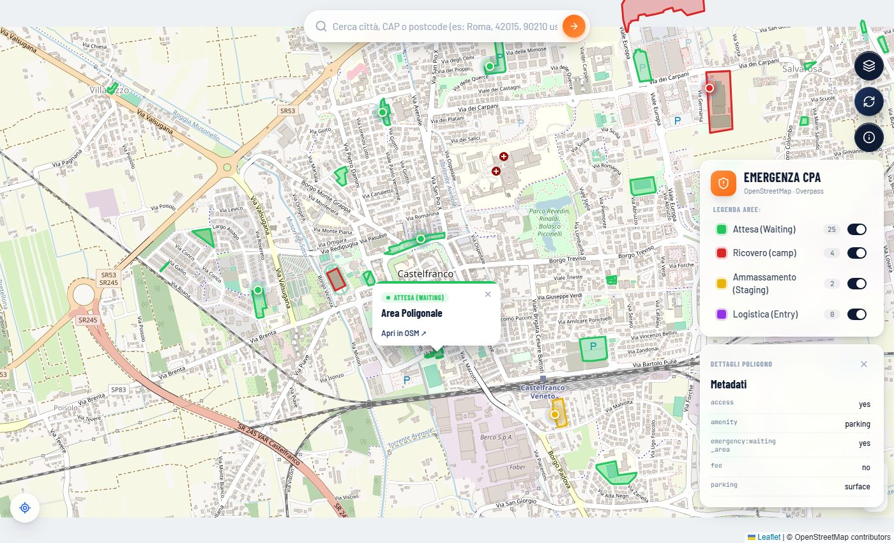
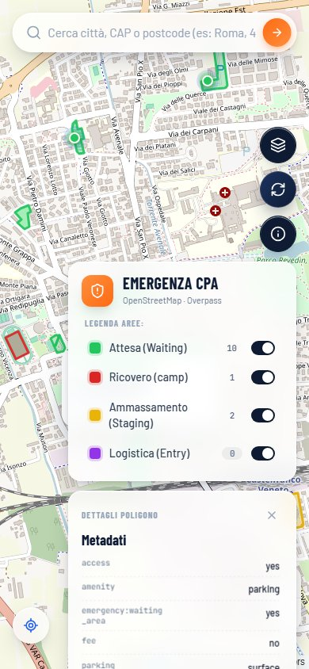
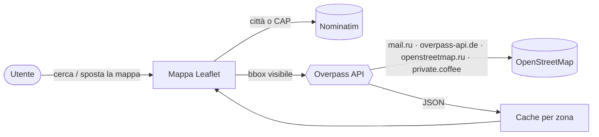

<div align="center">

# 🛡️ Emergenza CPA

**Le aree di emergenza della Protezione Civile, su una mappa, ovunque nel mondo.**

Attesa · Ricovero · Ammassamento · Logistica — direttamente dai dati aperti di OpenStreetMap.

[](https://andreadp271.github.io/civil_protection_areas_osm/)


<br>


&nbsp;


</div>

---

## ✨ Cosa fa

In caso di emergenza, sapere **dove andare** conta. I Comuni pubblicano i piani di protezione civile in PDF difficili da trovare; molte di quelle aree sono però già mappate su OpenStreetMap. Questa app le mostra su una mappa veloce, da telefono, senza installare nulla.

| | |
|---|---|
| 🔎 **Ricerca globale** | Città o CAP di qualsiasi paese (`42015 it`, `90210 us`, `28013 es`) |
| 📍 **Posizione** | Centra la mappa su di te e carica le aree vicine |
| 🗂️ **Filtri per tipo** | Accendi/spegni ogni categoria, con il conteggio in tempo reale |
| 🧾 **Dettagli** | Tocca un'area per vedere gestore, capienza e tutti i tag OSM |
| ⚡ **Leggera** | Un solo file HTML, cache delle zone già viste, fallback su più server |
| 🌍 **Bilingue** | Italiano o inglese in base alla lingua del browser |

## 🗺️ Legenda

| | Tipo | Tag OpenStreetMap |
|:-:|---|---|
| 🟩 | **Attesa** — dove ritrovarsi subito dopo l'evento | `emergency:waiting_area=yes` |
| 🟥 | **Ricovero** — tendopoli e strutture di accoglienza | `emergency:camp_area=yes` |
| 🟨 | **Ammassamento** — mezzi e soccorritori | `emergency:staging_area=rescue` |
| 🟪 | **Logistica** — punti di accesso dei soccorsi | `emergency:logistic_entry=rescue` |

Vengono mostrati poligoni (`way`), aree mappate come punto e cartelli (`man_made=sign`) con gli stessi tag.

## ⚙️ Come funziona



- Ogni spostamento della mappa interroga **Overpass** solo per l'area visibile (con debounce).
- Se un server non risponde entro 20 s si passa al successivo; le zone già scaricate restano in cache.
- Nessun backend, nessun account, nessun tracciamento.

## 🚀 Avvio in locale

Non serve installare niente:

```bash
git clone https://github.com/AndreaDp271/civil_protection_areas_osm.git
cd civil_protection_areas_osm
python -m http.server 8000
```

Poi apri <http://localhost:8000>. Per il deploy basta GitHub Pages sul branch `main`.

## 🤝 La tua città non compare?

Vuol dire che le aree non sono ancora su OpenStreetMap — e puoi aggiungerle tu.

1. Trova il **piano di protezione civile** del tuo Comune (di solito un PDF sul sito istituzionale).
2. Apri [openstreetmap.org](https://www.openstreetmap.org), accedi e disegna l'area con l'editor.
3. Aggiungi il tag giusto dalla legenda qui sopra, più `operator=*` e `source=*` con il link al piano.

Dopo qualche minuto l'area apparirà anche qui. 🎉

> [!NOTE]
> I dati provengono da volontari e possono essere incompleti. In emergenza fa sempre fede il piano ufficiale del tuo Comune.

---

<details>
<summary>🇬🇧 <b>English</b></summary>

<br>

**Emergenza CPA** shows civil protection emergency areas (waiting, shelter, staging, logistics) from OpenStreetMap on a fast, mobile-friendly map. Search any city or postal code worldwide, filter by type, tap an area for details. Single HTML file, no backend, data via Overpass API with automatic fallback across servers.

Missing areas in your town? Add them to OpenStreetMap using the tags in the legend above.

</details>

<div align="center">
<sub>Dati © <a href="https://www.openstreetmap.org/copyright">OpenStreetMap contributors</a>, ODbL</sub>
</div>
